# plan.md — MUSINSA AI Shopping Assistant

## 원본 해부

### 1. 대상과 방법
- 대상: 무신사 웹 `www.musinsa.com` (로그인 없이 접근 가능한 화면만, 앱 파일은 열지 않음)
- 사용 도구: **Wappalyzer**(Technology lookup), Chrome 개발자도구 Network 탭(Fetch/XHR), 페이지에 내장된 `__NEXT_DATA__` 확인
- 일시: 2026-10-27
- 범위: 홈 → 검색 → 검색 결과 → 상품 상세 → 랭킹. 찜 목록은 로그인이 필요하므로 제외

### 2. 기술 스택

#### 2-1. Wappalyzer 결과 (wappalyzer.com Technology lookup, `musinsa.com`, 2026-10-27)

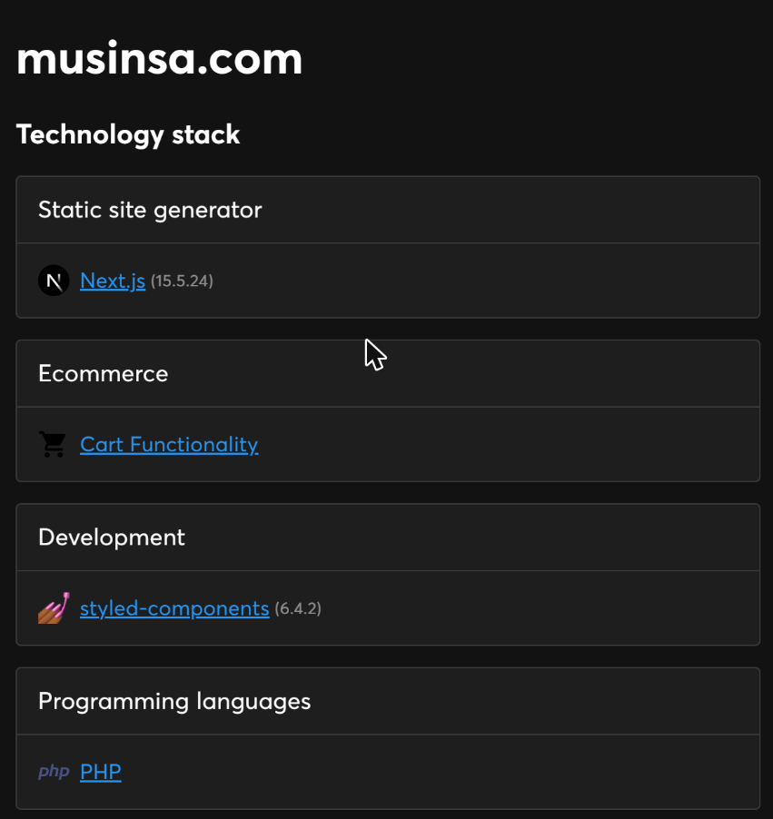
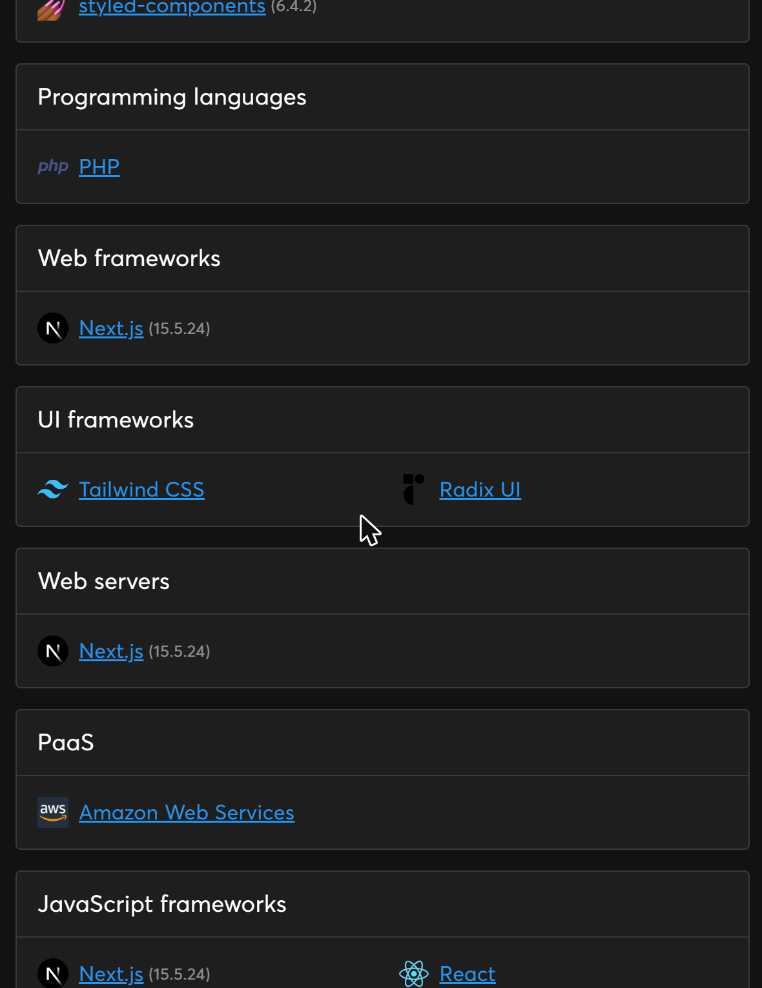
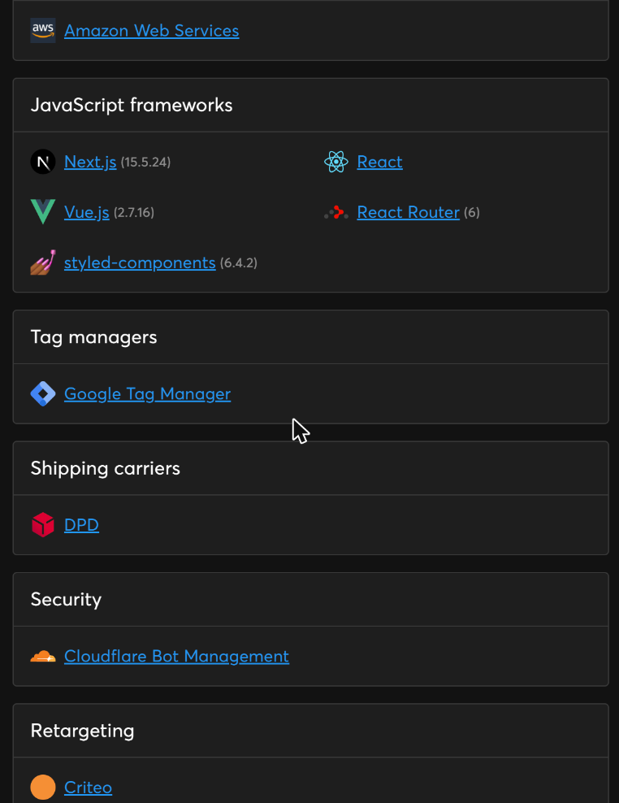
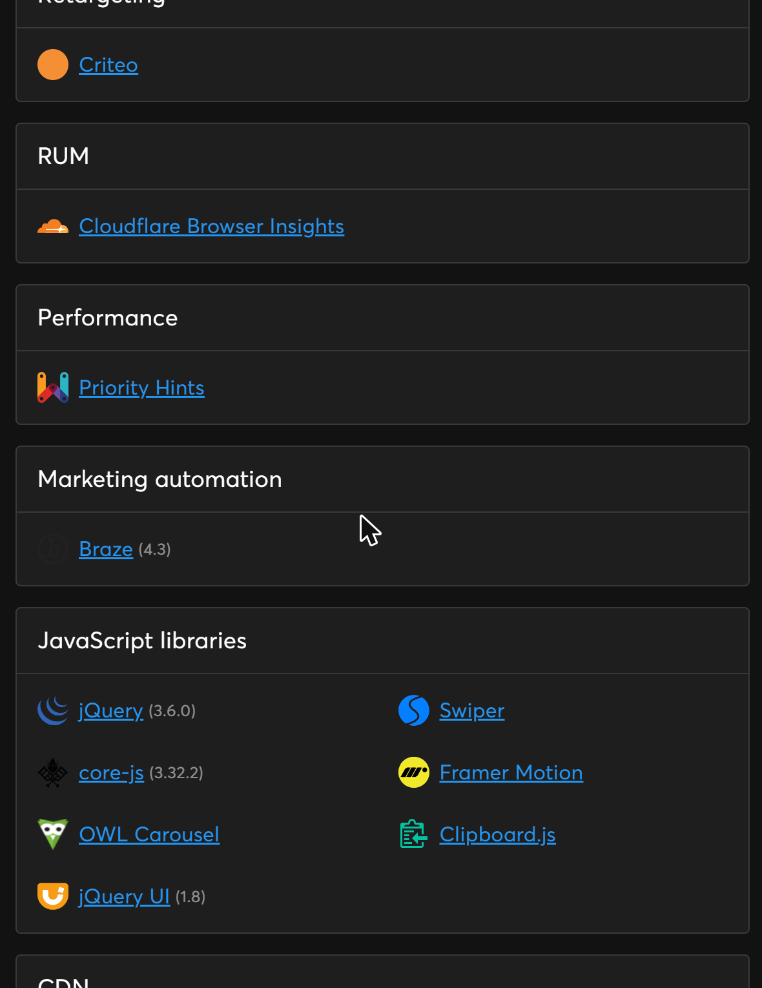
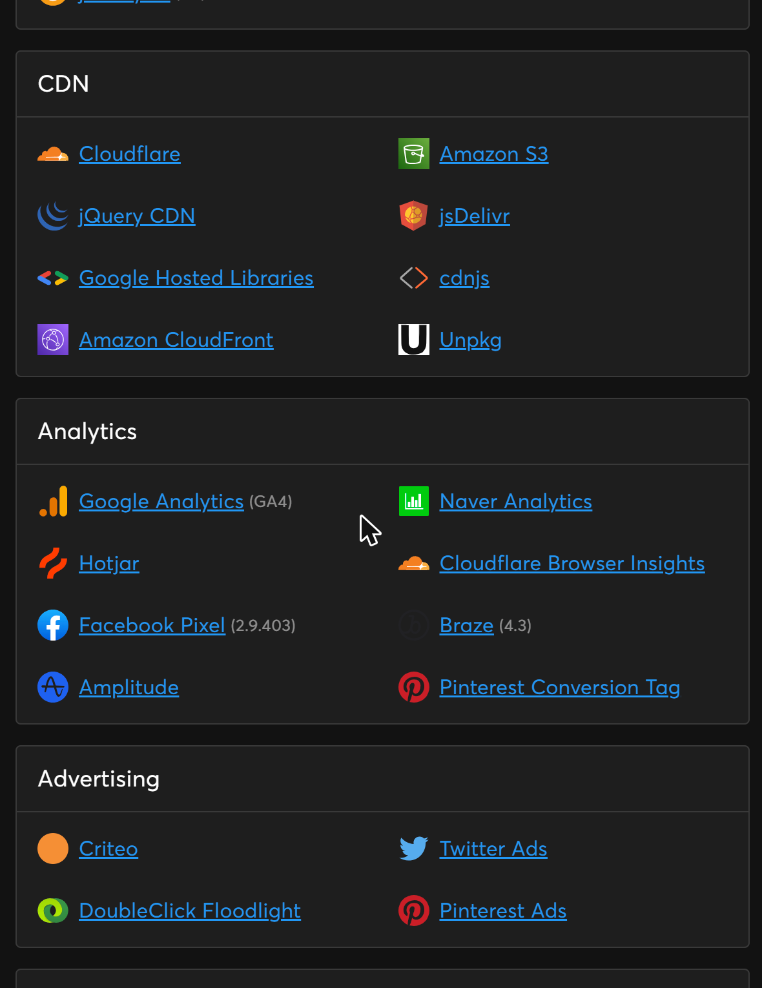

| 분류 | 감지 결과 |
|---|---|
| 웹 프레임워크 · 서버 | Next.js 15.5.24 |
| JavaScript 프레임워크 | Next.js, React, Vue.js 2.7.16, React Router 6, styled-components 6.4.2 |
| UI 프레임워크 | Tailwind CSS, Radix UI |
| 프로그래밍 언어 | PHP |
| JavaScript 라이브러리 | jQuery 3.6.0, jQuery UI 1.8, core-js 3.32.2, Swiper, Framer Motion, OWL Carousel, Clipboard.js |
| PaaS · CDN | Amazon Web Services, Amazon S3, Amazon CloudFront, Cloudflare, jsDelivr, cdnjs, Unpkg, Google Hosted Libraries, jQuery CDN |
| 보안 · 성능 | Cloudflare Bot Management, Cloudflare Browser Insights(RUM), Priority Hints, HTTP/3 |
| 태그 매니저 · 분석 | Google Tag Manager, Google Analytics(GA4), Amplitude, Hotjar, Naver Analytics, Facebook Pixel 2.9.403, Pinterest Conversion Tag |
| 마케팅 자동화 | Braze 4.3 |
| 광고 · 리타게팅 | Criteo, DoubleClick Floodlight, Twitter Ads, Pinterest Ads |
| 기타 | Kakao SDK 1.44.0, Open Graph, LottieFiles, Cart Functionality |

#### 2-2. 직접 검사와 대조

Wappalyzer lookup은 `musinsa.com` 도메인 전체를 오랜 기간 수집한 결과다. 오늘 검색·상세·랭킹 페이지를 직접 열어 확인한 결과와 비교했다.

| 항목 | Wappalyzer | 직접 검사 (검색·상세·랭킹 페이지) | 해석 |
|---|---|---|---|
| Next.js | 15.5.24 | `window.__NEXT_DATA__`, `page: "/search/[[...tabId]]"`, `"/products/[productId]"` | 일치. `__NEXT_DATA__`가 있으므로 **Pages Router** 방식 |
| React · styled-components | 감지 | `<style data-styled>` 확인 | 일치 |
| 데이터 캐시 | (감지 안 됨) | `dehydratedState.queries[].queryKey` → React Query(TanStack Query) | Wappalyzer가 못 잡은 것을 직접 검사로 보완 |
| 렌더링 | Static site generator로 분류 | 첫 페이지 상품 목록이 HTML 안에 이미 들어 있고(SSR), 2페이지부터 API 호출 | 정적 생성이 아니라 요청마다 서버에서 그리는 SSR로 판단 (추정) |
| PHP · jQuery · Vue 2.7 | 감지 | 오늘 본 페이지에서는 확인 안 됨 | 도메인 안의 예전 페이지나 일부 하위 서비스에 남은 기술로 추정 |
| Tailwind CSS | 감지 | `text-*`, `font-*` 클래스가 styled-components와 함께 쓰임 | 신규 화면에 섞어 쓰는 것으로 추정 |
| 분석 도구 | GA4, Amplitude, Hotjar, Braze 등 | 같은 도메인 스크립트 확인 + Maze, 당근 픽셀 | 대부분 일치 |

API는 기능별로 도메인이 나뉘어 있다 (Network 탭 관찰).

API는 기능별로 도메인이 나뉘어 있다.

| 도메인 | 역할 |
|---|---|
| `api.musinsa.com/api2/dp/...` | 검색·목록·필터 (display) |
| `goods-detail.musinsa.com/api2/goods/{id}/...` | 상품 상세 부가 정보 |
| `client.musinsa.com/api/home/web/v5/pans/...` | 홈·랭킹 |
| `like.musinsa.com` | 좋아요 수 |
| `cart.musinsa.com`, `my.musinsa.com` | 장바구니 개수, 로그인 상태 |
| `log.data.musinsa.com` | 노출·클릭 로그 |

### 3. 화면 흐름

| 순서 | 화면 | URL | 주요 구성 요소 |
|---|---|---|---|
| ① | 홈 | `/main/musinsa/recommend` | 상단 스토어 탭(MUSINSA·BEAUTY·SPORTS…), 검색창, 메뉴 탭(콘텐츠·추천·랭킹·세일…), 배너, 브랜드 바로가기 |
| ② | 검색 결과 | `/search/goods?keyword=…` | 결과 수, 빠른 필터 칩, 상세 필터, 정렬, 상품 그리드 |
| ③ | 검색 결과 없음 | `/search/goods?keyword=빵빵한 겨울 점퍼` | "총 0건", 그 아래에 검색어와 관계없는 추천 상품(뷰티 등) |
| ④ | 상품 상세 | `/products/{goodsNo}` | 이미지, 카테고리 경로, 브랜드, 별점·후기, 색상, 정가·할인율·판매가, 쿠폰, 컬러·사이즈 선택, 좋아요·구매하기(모바일은 하단 고정), 이미지 위 **"AI 추천 · 비슷한 상품"** 버튼 |
| ⑤ | 비슷한 상품 | `/recommend/similar?uuid=detail_goods_attributes_allbrand&goodsNo=…&limit=100` | "이 상품과 비슷한 상품" 목록 최대 100개, 새 상품/유즈드 탭 |
| ⑥ | 랭킹 | `/main/musinsa/ranking?sectionId=…&categoryCode=…&ageBand=…` | 일간 1위 브랜드, 기간·**스타일 탭**(스트리트·미니멀·프레피…)·카테고리 탭, 성별·연령·기간 드롭다운, 순위 그리드 |
| — | 찜 | (로그인 필요) | 분석 범위 밖 |

흐름: ① 홈 → (검색창) → ② 검색 결과 → ④ 상품 상세 → ⑤ 비슷한 상품 / 좋아요. ① 홈 → (랭킹 탭) → ⑥ 랭킹 → ④ 상품 상세.

우리 데모는 **모바일 최적화**로 만들기 때문에, 화면은 모바일 웹 기준으로 캡처했다 (헤드리스 Edge, iPhone 사용자 에이전트, 480×900 뷰포트, 로그인 안 함). 더 좁은 390px에서는 레이아웃 오른쪽이 잘려서, 하단 탭바 5개가 모두 보이는 480px을 썼다.

#### 3-1. 모바일 공통 구조

| 요소 | 위치 | 내용 | 우리 데모에 반영 |
|---|---|---|---|
| 앱 설치 배너 | 최상단 | "앱에서 다양한 혜택을 만나보세요" + 열기 | 제외 |
| 헤더 | 상단 | MUSINSA 로고 + 스토어 선택(▾), 적립·알림·장바구니 아이콘 | 로고·장바구니만 (명세서 S01) |
| 검색창 | 헤더 아래 | placeholder에 프로모션 문구 | 그대로 + "AI로 찾아보기" 진입점 |
| 메뉴 탭 | 검색창 아래, 가로 스크롤 | 콘텐츠·추천·랭킹·세일·발매·기획전 | 추천·랭킹 정도만 |
| **하단 탭바** | 하단 고정 | 브랜드(일부 화면은 카테고리)·스냅·홈·좋아요·마이, 5개 | 홈·검색·AI·찜 등으로 재구성 (A와 합의) |
| 성별 토글 | 하단 탭바 위, 떠 있음 | 전체·남성·여성 | 제외 가능 |
| 공유 버튼 | 왼쪽 아래, 떠 있음 | 공유 | 제외 |
| 상세 구매 바 | 상세 화면 하단 고정 | 좋아요(수) + 구매하기 | 찜 + 시연용 구매 버튼 (명세서 S04) |

#### 3-2. 화면별 캡처

| ① 홈 | ② 검색 결과 (`검정 후드티`) | ③ 검색 결과 없음 (`빵빵한 겨울 점퍼`) |
|---|---|---|
| 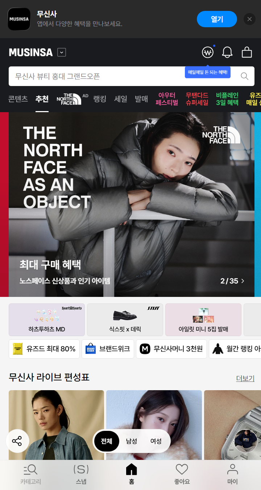 | 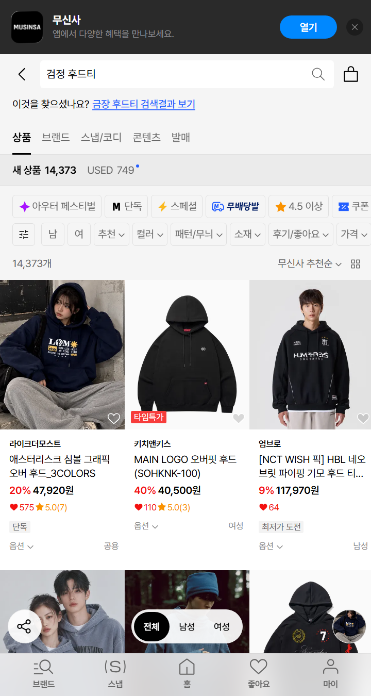 | 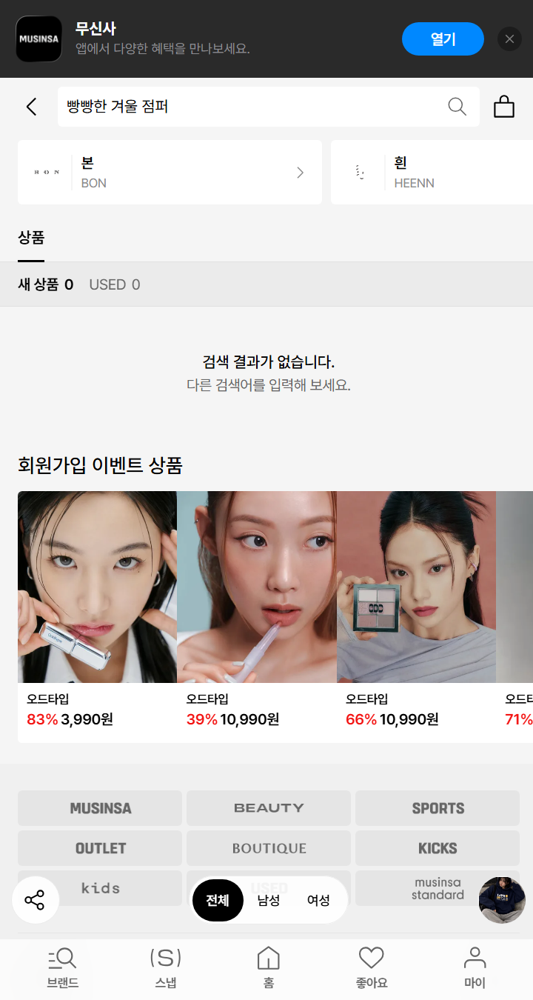 |

| ④ 상품 상세 | ⑤ 비슷한 상품 (AI 추천) | ⑥ 랭킹 |
|---|---|---|
| 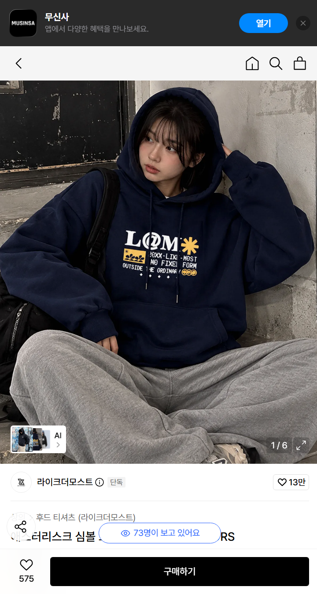 | 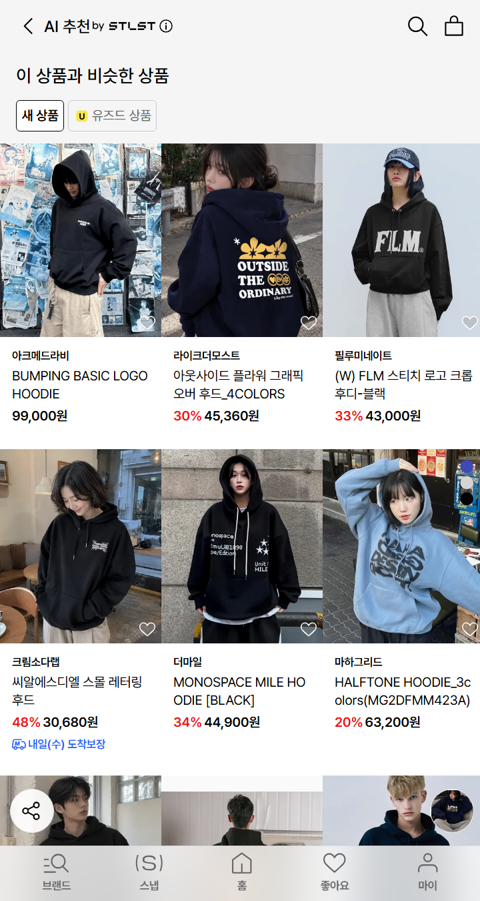 | 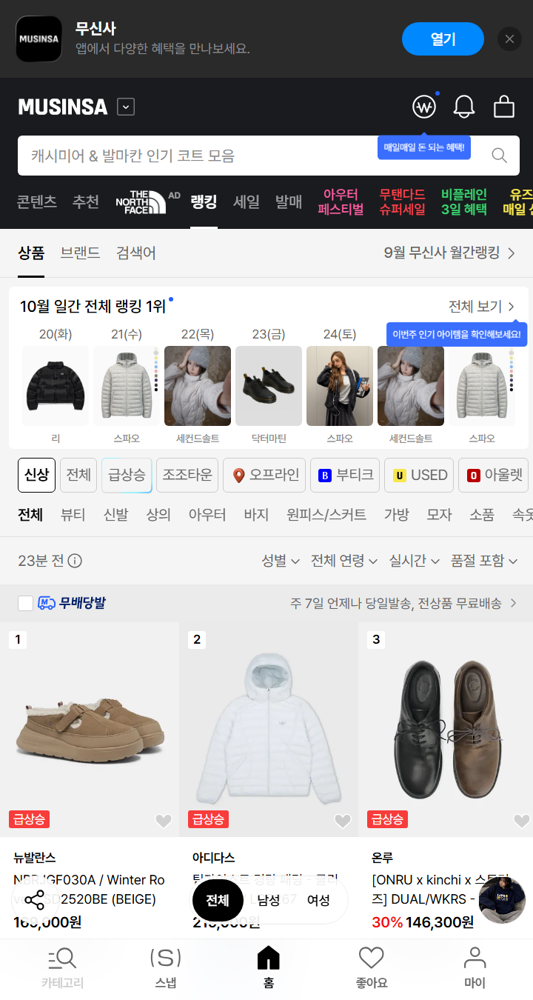 |

화면별 관찰:
- ② 검색어 아래 "이것을 찾으셨나요? **금장 후드티** 검색결과 보기"가 뜬다 (4-1의 오타 교정 API). 결과 그리드는 480px에서 3열이다.
- ③ "검색 결과가 없습니다. 다른 검색어를 입력해 보세요." 아래에 "회원가입 이벤트 상품"(뷰티)이 나온다. 조건 완화 제안은 없다.
- ④ 이미지 왼쪽 아래 작은 "AI >" 버튼이 ⑤로 이어진다. "73명이 보고 있어요" 같은 실시간 문구가 있다.
- ⑤ 상단 제목이 **"AI 추천 by STLST"**이다. 결과는 그리드만 있고 입력창이나 조건 칩은 없다.
- ⑥ 스타일 탭(스트리트·미니멀…)은 첫 화면에서 보이지 않고, 매장 탭 줄을 가로로 넘겨야 나온다.

(데스크톱 화면 캡처 `screen-*.jpg`도 같은 폴더에 참고용으로 남겨 둔다.)

### 4. 검색 동작 분석

#### 4-1. 요청 구조

| 사용자 행동 | 요청 | 주요 파라미터 | 관찰 |
|---|---|---|---|
| 검색어 입력 | 첫 페이지는 SSR, 이후 `GET api.musinsa.com/api2/dp/v2/plp/goods` | `keyword`, `gf`, `sortCode`, `page`, `size=60`, `caller=SEARCH` | 한 번에 60개씩 |
| 오타 교정 | `GET /api2/dp/v1/keyword/correction` | `keyword` | "검정 후드티" → 제안어 "금장 후드티" |
| 컬러 필터 | 위와 같은 요청 | `color=BLACK` (69개 색상 코드) | 결과 수 변화 확인 |
| 가격 필터 | 위와 같은 요청 | `minPrice`, `maxPrice` | 화면 URL에서는 `price=0^50000` 형식, API에서는 `minPrice/maxPrice`가 적용됨 |
| 카테고리 필터 | 위와 같은 요청 | `category=001`(상의), `002`(아우터), `003`(바지) … | 대분류 11개 |
| 정렬 | 위와 같은 요청 | `sortCode=POPULAR`, `LOW_PRICE` … | 기본값 "무신사 추천순" |
| 브랜드 필터 목록 | `GET /api2/dp/v1/plp/filter/brands` | `keyword`, `caller=SEARCH` | |

#### 4-2. 검색 필터에 있는 것과 없는 것

| 있음 | 없음 |
|---|---|
| 성별, 컬러, 패턴/무늬, 소재, 후기/좋아요, 가격, 카테고리, 사이즈, 핏, 브랜드, 혜택(단독·쿠폰·최저가 등) | **스타일**(스트릿·미니멀 등), **계절**, **착용 상황** |

- 스타일은 **랭킹 화면의 탭**으로만 존재한다 (전체 `sectionId=200`, 스트리트 `sectionId=203`). 검색과 함께 쓸 수 없다.
- 계절은 상품 데이터에 `season` 코드가 있지만 검색 필터로는 제공되지 않는다.

#### 4-3. 자연어 입력 실험 (2026-10-27, 전체 성별)

| 검색어 / 조건 | 결과 수 | 관찰 |
|---|---|---|
| `검정 후드티` | 14,373 | 첫 페이지 61개 중 이름에 블랙·검정이 들어간 상품은 17개. "검정"이 컬러 필터로 바뀌지 않는다(추정) |
| `후드티` + `color=BLACK` | 12,411 | 필터를 직접 걸어야 색이 적용된다 |
| `후드티` + `color=BLACK` + 5만 원 이하 | 4,991 | |
| `겨울에 입을 깔끔한 검은색 외투` | **0** | 문장 입력은 결과가 없다 |
| `빵빵한 겨울 점퍼` | **0** | 일상 표현은 인식하지 못한다 |
| `패딩` | 33,853 | 정확한 상품 용어를 알아야 결과가 나온다 |

결과가 0건이면 조건을 완화하자는 제안 없이, 검색어와 관계없는 추천 상품(뷰티 제품 등)이 표시된다.

#### 4-4. 원본에 이미 있는 추천 기능

| 기능 | 위치 · 요청 | 할 수 있는 것 | 할 수 없는 것 |
|---|---|---|---|
| AI 추천 · 비슷한 상품 | 상품 상세 이미지 위 버튼 → `/recommend/similar?uuid=detail_goods_attributes_allbrand&goodsNo=…&limit=100` | 기준 상품과 속성(`attributes`)이 비슷한 상품 최대 100개를 한 번에 보여 줌. 예시 후드 → 다른 브랜드 후드 목록 | "더 싸게", "더 스트릿하게"처럼 조건을 덧붙이거나 바꾸기. 왜 비슷한지 설명하기 |
| 이미지 검색 (추정) | 검색 페이지 데이터에 `ssrLensEntrySupported` 플래그 | 사진으로 검색하는 진입점이 있을 가능성 | 웹에서는 진입점을 확인하지 못함. 앱 기능일 가능성 (추정) |

→ "비슷한 상품 찾기" 자체는 원본에도 있다. 우리가 다른 점은 **비슷한 상품에 조건을 대화로 덧붙이는 것**(시나리오 D: "비슷한데 더 저렴한 것")과 **추천 이유를 설명하는 것**이다.

### 5. 값의 출처·추정 테이블

예시 상품: `goodsNo 7424693` (라이크더모스트 애스터리스크 심볼 그래픽 오버 후드)

| 화면 | 표시 값 | 출처 (요청 · 응답 필드) | 확인 / 추정 | 근거 |
|---|---|---|---|---|
| 상품 카드 | 판매가 47,920원 | 검색 목록 `items[].price` (= `finalPrice`) | 확인 | 화면 값과 일치 |
| 상품 카드 | 정가 59,900원 | `items[].normalPrice` | 확인 | |
| 상품 카드 | 할인율 20% | `items[].saleRate` (= `finalDiscount`) | 확인 | 59,900 → 47,920은 20% 할인 |
| 상품 카드 | "단독" 라벨 | `items[].infoLabelList[].code = "EXCLUSIVE"` | 확인 | |
| 상품 카드 | 후기 수 7 · 평점 | `items[].reviewCount`, `reviewScore = 100` | 확인 / 추정 | `reviewScore`는 만족도 5점을 100점 기준으로 바꾼 값으로 추정 (상세의 `satisfactionScore = 5`) |
| 상품 상세 | 가격·할인 | SSR `meta.data.goodsPrice` (`salePrice`, `normalPrice`, `discountRate`) | 확인 | |
| 상품 상세 | 카테고리 | SSR Detail 쿼리 `category.categoryDepth1Name = 상의`, `Depth2 = 후드 티셔츠` | 확인 | |
| 상품 상세 | 성별 | `sex = ["남성","여성"]` | 확인 | 카드에는 "공용"으로 표시 |
| 상품 상세 | 시즌 | `seasonYear = "2026"`, `season = "2"` | 추정 | 코드 "2"의 의미는 비공개. 태그 "26FW"로 보아 가을·겨울로 추정 |
| 상품 상세 | 태그 | `GET goods-detail…/{id}/tags` → `26FW, 그래픽후드티, 오버핏후드…` | 추정 | 판매자가 입력한 검색 키워드로 추정 |
| 상품 상세 | 소재 | `goodsMaterial.materials` | 확인 | 이 상품은 비어 있다 (상품마다 입력 여부가 다름) |
| (화면 표시 위치 미확인) | 조회 11,676 · 구매 215 | `GET goods-detail…/{id}/stat` | 확인 | |
| 랭킹 | 순위 | `GET client.musinsa.com/api/home/web/v5/pans/ranking/sections/{sectionId}` (`period=REALTIME`, `categoryCode`, `ageBand`) | 확인 / 추정 | 요청은 확인했고, 순위 산정 기준은 공개되지 않음 |
| 상품 카드 | 좋아요 수 | `like.musinsa.com/like/api/v2/liketypes/goods/counts` | 추정 | 요청은 확인했고, 요청 본문은 확인하지 않음 |

### 6. 해부에서 얻은 결론
- **원본 검색이 요구하는 것**: 정확한 상품 용어(키워드)와, 사용자가 직접 고르는 필터 파라미터(`color`, `category`, `minPrice/maxPrice`, `sortCode`). 문장이나 일상 표현은 0건이고, "검정"이라고 써도 컬러 필터로 바뀌지 않는다.
- **원본에 없는 것**: 검색에서 스타일·계절·착용 상황으로 거르기. 스타일은 랭킹 탭에만 있다. 조건을 대화로 이어서 바꾸는 기능도 없다. "비슷한 상품" 추천은 있지만 한 번 보여 주고 끝나서, 조건을 덧붙이거나 이유를 설명하지 않는다. 결과가 0건일 때도 조건 완화를 제안하지 않는다.
- **그래서 우리가 만든 기능**: 자연어 문장을 원본 필터와 같은 구조의 조건으로 바꾸고(`parseQuery`), 원본 검색에 없는 스타일·계절·제외 조건까지 다루며, 대화를 이어가면서 조건을 바꾸는 AI 쇼핑 어시스턴트.

| 우리 `SearchConditions` | 원본 파라미터 | 비고 |
|---|---|---|
| `category` | `category` (001 상의, 002 아우터, 003 바지 …) | |
| `color` | `color` (`BLACK`, `NAVY` …) | |
| `maxPrice` / `minPrice` | `maxPrice` / `minPrice` | |
| `sort` | `sortCode` (`POPULAR`, `LOW_PRICE` …) | |
| `fit` | `attributeFitGroup` | |
| `style` | (검색에는 없음, 랭킹 `sectionId`) | 우리가 추가 |
| `season` | (검색에는 없음, 상품에 `season` 코드) | 우리가 추가 |
| `exclude` | 없음 | 우리가 추가 |
